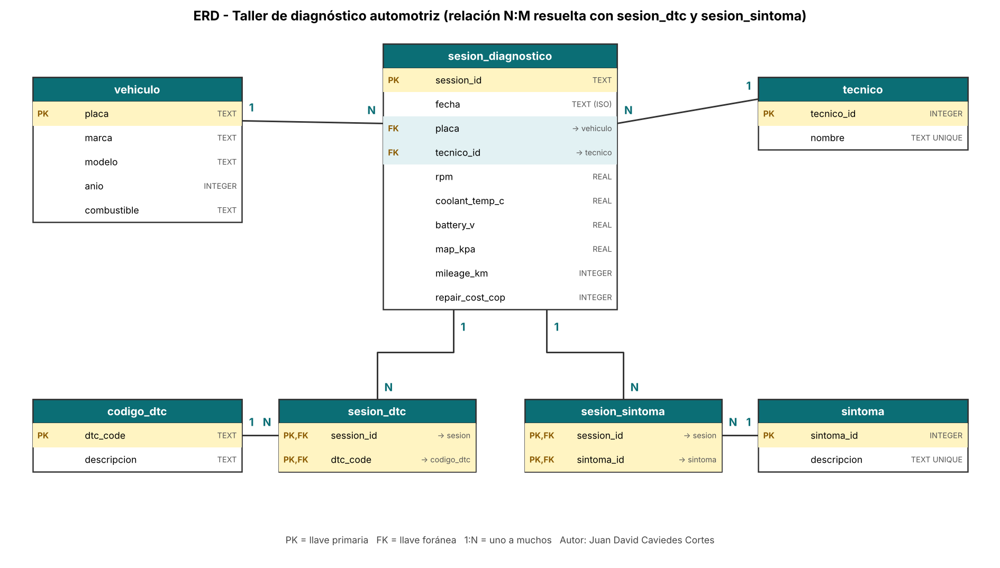

# Semana 6 · ERD de mi caso: taller de diagnóstico automotriz

```python
FULL_NAME   = "Juan David Caviedes Cortes"
GITHUB_USER = "davidcaviedes499-ship-it"
```

Asignatura: Ciencia de Datos · Ingeniería Industrial · Corporación Universitaria del Huila (CORHUILA) · 2026-B · Corte 2.
Guía de la actividad: *Semana 6 · ERD de tu caso* (formativa, opcional).

## 1. Caso y datos

El caso es un **taller que diagnostica vehículos con escáner OBD-II**. Cada visita registra el vehículo, el técnico, un código de falla (DTC), el síntoma que reporta el cliente, cuatro lecturas del motor (RPM, temperatura del refrigerante, voltaje de batería y presión MAP), el kilometraje y el costo de la reparación.

El dataset (`data/diagnostics_clean.csv`) tiene **240 sesiones**, entre el 2026-01-01 y el 2026-09-28, de **10 vehículos**, **4 técnicos**, **7 códigos DTC** y **7 síntomas** (uno de ellos es `Unknown`).

## 2. ERD



La versión en Mermaid está en [`erd.md`](erd.md) y el DDL completo en [`schema.sql`](schema.sql).

| Entidad | PK | FK | Qué guarda |
|---|---|---|---|
| `vehiculo` | `placa` | – | Marca, modelo, año y combustible, una sola vez por vehículo |
| `tecnico` | `tecnico_id` | – | Nombre del técnico (único) |
| `codigo_dtc` | `dtc_code` | – | Catálogo de códigos con su descripción |
| `sintoma` | `sintoma_id` | – | Catálogo de síntomas |
| `sesion_diagnostico` | `session_id` | `placa`, `tecnico_id` | La visita: fecha, lecturas, kilometraje y costo |
| `sesion_dtc` | (`session_id`, `dtc_code`) | ambas | **Tabla intermedia N:M** sesión ↔ código |
| `sesion_sintoma` | (`session_id`, `sintoma_id`) | ambas | **Tabla intermedia N:M** sesión ↔ síntoma |

### Relaciones

- `vehiculo` 1:N `sesion_diagnostico`: un vehículo vuelve al taller muchas veces.
- `tecnico` 1:N `sesion_diagnostico`: un técnico atiende muchas sesiones.
- `sesion_diagnostico` N:M `codigo_dtc`, resuelta con `sesion_dtc`: una sesión puede dejar varios códigos y un código aparece en muchas sesiones.
- `sesion_diagnostico` N:M `sintoma`, resuelta con `sesion_sintoma`: mismo razonamiento.

> **Aclaración honesta:** en los datos actuales cada sesión tiene exactamente un código y un síntoma, así que las dos tablas intermedias hoy tienen 240 filas (una por sesión). Las dejé como N:M porque un escáner real puede devolver varios DTC en la misma visita y el modelo no debería romperse cuando eso ocurra.

## 3. ¿Relacional o NoSQL?

**Elegí el enfoque relacional (SQL).** Las razones, ligadas a este caso:

1. **Los datos son tabulares y de esquema fijo.** Las 16 columnas del CSV son siempre las mismas y cada sesión trae los mismos campos.
2. **Hay relaciones claras y consultas que las cruzan.** Preguntas como "costo promedio por código DTC" o "sesiones por técnico y marca" necesitan `JOIN` y `GROUP BY`, que es lo que mejor hace SQL (Codd, 1970; Elmasri y Navathe, 2016).
3. **Se necesita integridad.** Con llaves foráneas no puede existir una sesión de una placa que no esté registrada ni un código DTC fuera del catálogo.
4. **El volumen es pequeño** (240 filas). No hay un problema de escala horizontal que justifique un motor de documentos.

**Cuándo cambiaría de opinión:** si el taller empezara a guardar la telemetría completa del escáner (cientos de lecturas por segundo, con campos que cambian según el vehículo), esa parte encajaría mejor en un almacén de documentos o de series de tiempo (MongoDB, s. f.), mientras que el catálogo y las visitas seguirían en SQL.

## 4. Normalización: qué evité repetir

El CSV original es una **tabla plana**: marca, modelo, año y combustible se repiten en cada visita del mismo vehículo. El modelo lo reorganiza así (Date, 2019):

| Forma normal | Qué apliqué | Redundancia evitada |
|---|---|---|
| **1FN** | Cada celda guarda un solo valor; el DTC y el síntoma viven en tablas propias, no como listas en una celda. | Listas de códigos en una columna. |
| **2FN / 3FN** | `marca`, `modelo`, `anio` y `combustible` dependen de la **placa**, no de la sesión, así que pasan a `vehiculo`. Verifiqué en los datos que cada placa tiene exactamente una combinación de esos atributos. | Esos 4 datos se repetían en las 240 filas; ahora se guardan 10 veces (una por vehículo). |
| **3FN** | La descripción del DTC depende del código, no de la sesión: va en `codigo_dtc`. El nombre del técnico va en `tecnico`. | La descripción se guarda 7 veces en total, no 240; el nombre del técnico, 4 veces. |

Beneficio práctico: si cambia el nombre de un técnico o se corrige la descripción de un código, se actualiza **una** fila y no cientos.

## 5. Cómo reproducirlo

```bash
python build_db.py        # crea diagnostics.db con las 7 tablas y verifica las llaves foráneas
python dibujar_erd.py     # regenera erd.png
```

Resultado de la carga: `vehiculo` 10 · `tecnico` 4 · `codigo_dtc` 7 · `sintoma` 7 · `sesion_diagnostico` 240 · `sesion_dtc` 240 · `sesion_sintoma` 240, con **0 violaciones de llave foránea**.

## 6. Limitaciones

- Las descripciones de los DTC son las definiciones genéricas OBD-II; un fabricante puede darles significados propios a algunos códigos.
- El kilometraje no crece de forma coherente entre visitas del mismo vehículo (en 116 de 230 pares de visitas consecutivas baja). Por eso lo guardé como atributo de la sesión y no lo uso como tendencia.
- 32 sesiones tienen costo 0; no sé si significan garantía, revisión gratuita o dato faltante, así que no los traté como error.

## 7. Referencias

Chen, P. P. (1976). The entity-relationship model—Toward a unified view of data. *ACM Transactions on Database Systems, 1*(1), 9–36.

CORHUILA. (2026). *Ciencia de Datos · Semana 6 · Modelamiento de datos* [Material de clase]. Corporación Universitaria del Huila. https://code-corhuila.github.io/ova-web/2026-B/ciencia-datos/06-week/01-session/

Codd, E. F. (1970). A relational model of data for large shared data banks. *Communications of the ACM, 13*(6), 377–387.

Date, C. J. (2019). *Database design and relational theory: Normal forms and all that jazz* (2.ª ed.). Apress.

Elmasri, R., y Navathe, S. B. (2016). *Fundamentals of database systems* (7.ª ed.). Pearson.

Mermaid. (s. f.). *Entity relationship diagrams*. https://mermaid.js.org/syntax/entityRelationshipDiagram.html

MongoDB. (s. f.). *Data modeling*. https://www.mongodb.com/docs/manual/data-modeling/

SAE International. (s. f.). *SAE J2012: Diagnostic trouble code definitions* [Norma técnica].

SQLite. (s. f.). *SQLite foreign key support*. https://www.sqlite.org/foreignkeys.html
