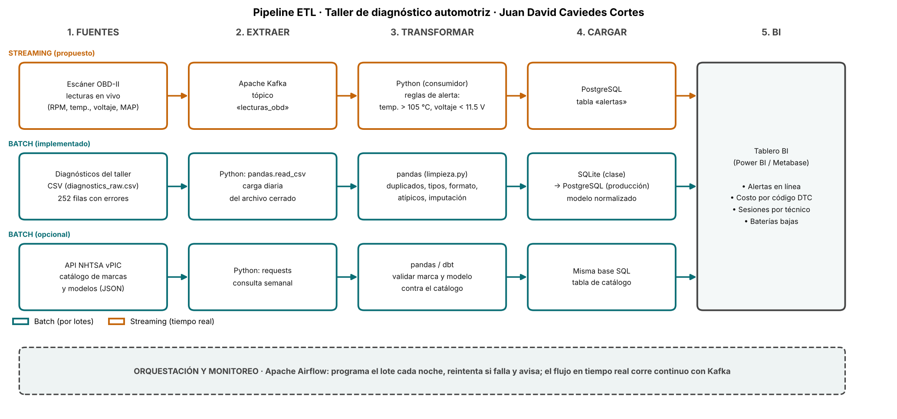

# Semana 8 · Pipeline ETL del taller de diagnóstico automotriz

```python
FULL_NAME   = "Juan David Caviedes Cortes"
GITHUB_USER = "davidcaviedes499-ship-it"
```

Asignatura: Ciencia de Datos · Ingeniería Industrial · CORHUILA · 2026-B · Corte 2.
Guía de la actividad: *Semana 8 · Diseña un pipeline ETL* (formativa, opcional).

## Qué se entrega

| Archivo | Contenido |
|---|---|
| [`pipeline_etl.png`](pipeline_etl.png) | Diagrama del pipeline con la herramienta de cada paso |
| [`pipeline.mmd`](pipeline.mmd) | El mismo diagrama en Mermaid (editable) |
| [`consumir_api.py`](consumir_api.py) | Consumo de una API pública con `requests`; muestra 3 registros (parte opcional) |
| [`api_sample.json`](api_sample.json) | Muestra guardada de la respuesta de la API, usada como respaldo |
| [`dibujar_pipeline.py`](dibujar_pipeline.py) | Genera la imagen del diagrama |

## 1. Pipeline: fuentes → extraer → transformar → cargar → BI



| Paso | Flujo por lotes (batch) | Flujo en tiempo real (streaming) |
|---|---|---|
| **Fuentes** | CSV de diagnósticos del taller; API NHTSA vPIC (catálogo de marcas y modelos) | Escáner OBD-II con lecturas en vivo |
| **Extraer** | `pandas.read_csv` (carga diaria); `requests` (consulta semanal) | Apache Kafka, tópico `lecturas_obd` |
| **Transformar** | `pandas`: duplicados, tipos, formato, atípicos e imputación ([`limpieza.py`](../09-week/limpieza.py)); `pandas`/`dbt` para validar marca y modelo | Consumidor en Python con reglas de alerta |
| **Cargar** | SQLite en clase → PostgreSQL en producción, con el modelo normalizado de la [semana 6](../06-week/README.md) | Tabla `alertas` en PostgreSQL |
| **BI** | Tablero en Power BI o Metabase: costo por código DTC, sesiones por técnico, baterías bajas | El mismo tablero, con un panel de alertas |
| **Orquestación** | Apache Airflow programa el lote nocturno, reintenta y avisa si falla | Kafka corre de forma continua |

Cada nombre de herramienta sale de la sesión de clase (Airflow orquesta, Kafka transporta eventos, `dbt` transforma dentro del almacén) y de la práctica de las semanas 6, 7 y 9.

**Qué está implementado y qué es diseño.** El flujo por lotes del CSV sí existe y funciona (semanas 6, 7 y 9, y se integra en la [semana 10](../10-week/README.md)). El flujo de streaming es una **propuesta de diseño**: hoy el taller no tiene un escáner conectado, así que no hay lecturas en vivo para transmitir. Lo marqué así en el diagrama («propuesto» vs. «implementado»).

## 2. ¿Qué es batch y qué es streaming? Justificación

### Batch (por lotes)

| Parte | Por qué va en batch |
|---|---|
| **CSV de diagnósticos** | Una sesión se registra cuando termina la visita. Las preguntas de negocio (costo por falla, carga por técnico) se contestan bien con un corte diario; nadie necesita la respuesta en segundos. |
| **Limpieza** | Imputo los faltantes con la **mediana por combustible**, y una mediana solo se puede calcular viendo el lote completo. Es batch por naturaleza. |
| **API NHTSA** | El catálogo de marcas y modelos cambia, como mucho, una vez al año. Consultarlo cada semana ya es más de lo necesario. |

### Streaming (propuesto, solo para alertas)

| Parte | Por qué va en streaming |
|---|---|
| **Alertas del escáner** | Una temperatura de refrigerante alta o un voltaje bajo vale la pena detectarlos **mientras el vehículo está en el taller**; avisar al día siguiente ya no sirve. |

**Por qué no pasar todo a streaming:** la sesión de clase advierte que usar streaming sin necesidad es un error común. Añade Kafka, más piezas que operar y más puntos de falla, y con 240 sesiones en nueve meses (alrededor de una al día) el lote nocturno basta. Por eso el streaming queda reservado para lo único que pierde valor con el retraso.

**Un detalle que me obliga a no darlo por cerrado:** los umbrales del diagrama (temperatura > 105 °C y voltaje < 11,5 V) son **supuestos de diseño míos**, no salen de un manual. Contrastados con los datos limpios actuales: ninguna sesión supera 105 °C (el máximo es 103,3 °C) y solo 2 bajan de 11,5 V. Es decir, con estos umbrales la regla de temperatura nunca se habría activado; antes de ponerla en producción habría que calibrarla con el manual del fabricante y datos reales del escáner.

## 3. Consumo de una API (parte opcional)

`consumir_api.py` consulta la API pública **NHTSA vPIC** (no requiere llave) y pide los modelos de Mazda del año 2020, una de las marcas del dataset:

```bash
python consumir_api.py                # Mazda 2020
python consumir_api.py toyota 2015    # otra marca y año
```

Salida (3 registros):

| marca_id | marca | modelo_id | modelo |
|---:|---|---:|---|
| 473 | MAZDA | 2072 | MX-5 |
| 473 | MAZDA | 2074 | Mazda3 |
| 473 | MAZDA | 2077 | CX-9 |

El script sigue el ciclo de ETL en miniatura: `extraer()` hace la petición con `requests`, `transformar()` convierte el JSON a tabla y renombra las columnas, y el resultado se guarda en `muestra_api_3_registros.csv`.

**Sobre cómo se probó (para que no haya malentendidos):**

- Esos 3 registros vienen de una consulta real al endpoint, hecha el 2026-10-14 desde una herramienta de lectura web; la API informó `Count = 8` y guardé los tres primeros en `api_sample.json`.
- Desde el entorno donde ejecuté el script **no había salida a internet** (error de proxy), así que lo que corrió fue la ruta de **respaldo** con esa muestra guardada, y el script lo avisa con un mensaje. La ruta «en vivo» (`requests.get`) está escrita pero **no la pude ejecutar aquí**; conviene correrla una vez en tu computador con conexión.
- Tampoco usé esta API para validar los modelos del dataset: es un catálogo del mercado de EE. UU. y modelos como el Picanto o el Hilux pueden no aparecer. Por eso en el diagrama esa fila está marcada como **opcional**.

## 4. Referencias

CORHUILA. (2026). *Ciencia de Datos · Semana 8 · Conexión de datos: APIs, ETL y pipelines* [Material de clase]. Corporación Universitaria del Huila. https://code-corhuila.github.io/ova-web/2026-B/ciencia-datos/08-week/01-session/

Kimball, R., y Ross, M. (2013). *The data warehouse toolkit: The definitive guide to dimensional modeling* (3.ª ed.). Wiley.

Kleppmann, M. (2017). *Designing data-intensive applications*. O'Reilly Media.

Mermaid. (s. f.). *Flowchart syntax*. https://mermaid.js.org/syntax/flowchart.html

National Highway Traffic Safety Administration. (s. f.). *Vehicle API (vPIC)*. U.S. Department of Transportation. https://vpic.nhtsa.dot.gov/api/

Reitz, K. (s. f.). *Requests: HTTP for humans* [Documentación]. https://requests.readthedocs.io/en/latest/

The Apache Software Foundation. (s. f.). *Apache Airflow documentation*. https://airflow.apache.org/docs/

The Apache Software Foundation. (s. f.). *Apache Kafka documentation*. https://kafka.apache.org/documentation/
