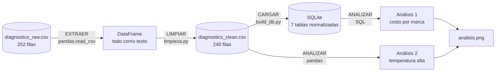

# Semana 10 · Mini-proyecto de datos (cierre del Corte 2)

```python
FULL_NAME   = "Juan David Caviedes Cortes"
GITHUB_USER = "davidcaviedes499-ship-it"
```

Asignatura: Ciencia de Datos · Ingeniería Industrial · CORHUILA · 2026-B · Corte 2.
Guía de la actividad: *Semana 10 · Mini-proyecto de datos (cierre C2)* (formativa, opcional).

**Caso:** un taller que diagnostica vehículos con escáner OBD-II. Este mini-proyecto junta, en un solo flujo, lo trabajado en las semanas 6 a 9: el modelo de datos, la carga y limpieza con pandas, y dos análisis con consultas.

## Qué se entrega

| Archivo | Contenido |
|---|---|
| [`pipeline.py`](pipeline.py) | El flujo completo: extraer → limpiar → cargar → analizar |
| [`data/diagnostics_raw.csv`](data/diagnostics_raw.csv) | Dataset original (252 filas, con errores) |
| [`erd.png`](erd.png) | Modelo de datos (ERD) del caso; detalle en la [semana 6](../06-week/README.md) |
| `salidas/diagnostics_clean.csv` | Datos limpios y listos para analizar (240 filas) |
| `salidas/diagnostics.db` | Los mismos datos en la base SQLite normalizada (7 tablas) |
| `salidas/analisis1_costo_por_marca.csv` | Resultado del análisis 1 (SQL) |
| `salidas/analisis2_temperatura_alta_por_vehiculo.csv` | Resultado del análisis 2 (pandas) |
| `salidas/analisis.png` | Gráfica de ambos análisis |

```bash
python pipeline.py     # necesita 06-week y 09-week al lado: reutiliza su código
```

## 1. Modelo de datos (ERD)


Siete tablas: `vehiculo`, `tecnico`, `codigo_dtc`, `sintoma`, `sesion_diagnostico` y las dos tablas intermedias de las relaciones N:M, `sesion_dtc` y `sesion_sintoma`. La justificación relacional vs. NoSQL y la normalización están en la [semana 6](../06-week/README.md).

## 2. Flujo documentado: extraer → limpiar → analizar



| Etapa | Función | Qué hace | Resultado medido |
|---|---|---|---|
| **Extraer** | `extraer()` | Lee el CSV crudo como texto, sin interpretar nada | 252 filas × 16 columnas |
| **Limpiar** | `limpiar_datos()` → `limpiar()` de la semana 9 | Quita duplicados, unifica fechas y texto, convierte tipos, corrige atípicos e imputa | Filas 252 → 240 · nulos 91 → 0 · duplicados 12 → 0 |
| **Cargar** | `cargar()` | Guarda el CSV limpio y lo carga en el modelo de la semana 6; verifica las llaves foráneas | 10 vehículos · 4 técnicos · 7 DTC · 7 síntomas · 240 sesiones · **0** violaciones de llave foránea |
| **Analizar** | `analizar()` | Dos consultas (filtro + agregación) y una verificación cruzada SQL vs. pandas | Ver sección 3 |

**Datos listos para analizar:** `salidas/diagnostics_clean.csv`, sin nulos ni duplicados, con fechas en ISO y números como números. El detalle de qué se corrigió y por qué está en la [semana 9](../09-week/README.md).

## 3. Dos análisis con consultas

### Análisis 1 (SQL): ¿qué marca tiene el costo promedio de reparación más alto?

Filtro: solo sesiones con costo mayor que 0. Agregación: promedio por marca.

```sql
SELECT v.marca,
       COUNT(*)                         AS sesiones_con_cobro,
       ROUND(AVG(s.repair_cost_cop), 0) AS costo_promedio_cop
FROM sesion_diagnostico AS s
JOIN vehiculo AS v ON v.placa = s.placa
WHERE s.repair_cost_cop > 0
GROUP BY v.marca
ORDER BY costo_promedio_cop DESC;
```

(La versión que ejecuta `pipeline.py` agrega una desviación estándar aproximada para poder juzgar la dispersión.)

| Marca | Sesiones con cobro | Costo promedio (COP) |
|---|---:|---:|
| Volkswagen | 16 | 483 750 |
| Hyundai | 24 | 392 917 |
| Toyota | 17 | 385 882 |
| Mazda | 22 | 383 182 |
| Ford | 25 | 377 200 |
| Suzuki | 20 | 372 500 |
| Kia | 14 | 340 714 |
| Renault | 22 | 322 727 |
| Nissan | 26 | 308 462 |
| Chevrolet | 22 | 285 455 |

**Lectura:** Volkswagen (Gol) tiene el promedio más alto, unos 484 mil COP, y Chevrolet (Spark) el más bajo, unos 285 mil. Excluí las 32 sesiones con costo 0 porque no sé si son garantías o datos faltantes; incluirlas bajaría todos los promedios.

**Qué no se puede concluir:** la diferencia no es concluyente. Cada promedio sale de entre 14 y 26 sesiones y la desviación estándar de los costos es de 220 000 a 340 000 COP, del mismo tamaño que las diferencias entre marcas. Como comprobación adicional (hecha aparte, con `scipy`, y no incluida en el script), un ANOVA de una vía entre las 10 marcas da **p ≈ 0,73**: con estos datos no hay evidencia de que el costo dependa de la marca. Elegir los extremos (Volkswagen frente a Chevrolet) de entre diez grupos siempre produce una brecha que parece grande.

### Análisis 2 (pandas): ¿qué vehículos registran más veces el refrigerante a 95 °C o más?

Filtro: `coolant_temp_c >= 95`. Agregación: sesiones con temperatura alta sobre el total de sesiones de cada vehículo.

```python
por_vehiculo = (limpio.groupby(["brand", "model"])
                .agg(sesiones=("session_id", "count"),
                     temp_alta=("coolant_temp_c", lambda s: int((s >= 95).sum())))
                .reset_index())
por_vehiculo["pct_sesiones_temp_alta"] = (
    100 * por_vehiculo["temp_alta"] / por_vehiculo["sesiones"]).round(1)
```

| Vehículo | Sesiones | Con temp. ≥ 95 °C | % |
|---|---:|---:|---:|
| Volkswagen Gol | 18 | 5 | 27,8 |
| Toyota Hilux | 19 | 5 | 26,3 |
| Hyundai Tucson | 27 | 6 | 22,2 |
| Nissan Frontier | 30 | 6 | 20,0 |
| Mazda CX-5 | 24 | 3 | 12,5 |
| Ford Ranger | 33 | 4 | 12,1 |
| Suzuki Swift | 20 | 2 | 10,0 |
| Chevrolet Spark | 26 | 2 | 7,7 |
| Kia Picanto | 16 | 1 | 6,2 |
| Renault Logan | 27 | 1 | 3,7 |

**Lectura:** el Gol y la Hilux son los que más veces llegan a 95 °C o más (más de una de cada cuatro visitas), y el Logan el que menos (una de 27).

**Cautelas:**

- Los conteos son muy pequeños (entre 1 y 6 sesiones por vehículo), así que los porcentajes son inestables: un solo caso más cambia varios puntos. El contraste extremo Gol frente a Logan tiene un p de unos 0,03 en una prueba exacta de Fisher, pero se eligió entre 10 vehículos, así que tampoco es una conclusión firme.
- El 95 °C es un umbral que escogí para el análisis, no una especificación del fabricante.
- Las lecturas de refrigerante que faltaban se imputaron con 88,3 °C (gasolina) o 90,3 °C (diésel), ambos **por debajo de 95**. Imputar no puede crear falsas alertas, pero sí puede ocultar alguna temperatura alta real: los porcentajes pueden estar subestimados.

**Verificación:** el análisis 1 se recalcula en pandas dentro de `pipeline.py` y el script falla si no coincide con el resultado de SQL. Con estos datos coinciden.

## 4. Limitaciones generales

- Parte de los datos son estimados: 89 celdas numéricas imputadas, en 77 de las 240 filas (32 %).
- Los datos parecen sintéticos (el kilometraje no crece de forma coherente entre visitas y hay combinaciones de código y vehículo poco plausibles), así que los hallazgos describen este archivo, no un taller real.
- No hay un análisis causal: se describen frecuencias y promedios.

## 5. Cómo se cubre la rúbrica

| Criterio | Dónde está |
|---|---|
| Modelo + carga + limpieza (50) | ERD en la sección 1; carga y limpieza en la sección 2 (`pipeline.py`) |
| 2 análisis con consultas (35) | Sección 3: uno en SQL y otro en pandas, ambos con filtro y agregación |
| Documentación del flujo (15) | Sección 2: diagrama, tabla de etapas con cifras medidas y este README |

## 6. Cómo entregarlo por GitHub

Desde la carpeta de tu fork del repositorio de la clase:

```bash
git add .
git commit -m "Entrega semana 10"
git push
```

La guía pide también tener el repositorio de perfil con el bloque CONFIG (`FULL_NAME` y `GITHUB_USER`); en el encabezado de este README dejé esos dos datos con ese formato por si sirve de referencia.

## 7. Referencias

Chen, P. P. (1976). The entity-relationship model—Toward a unified view of data. *ACM Transactions on Database Systems, 1*(1), 9–36.

CORHUILA. (2026). *Ciencia de Datos · Semana 10 · Repaso y evaluación del Corte 2* [Material de clase]. Corporación Universitaria del Huila. https://code-corhuila.github.io/ova-web/2026-B/ciencia-datos/10-week/01-session/

Kimball, R., y Ross, M. (2013). *The data warehouse toolkit: The definitive guide to dimensional modeling* (3.ª ed.). Wiley.

McKinney, W. (2022). *Python for data analysis* (3.ª ed.). O'Reilly Media.

Python Software Foundation. (s. f.). *sqlite3 — DB-API 2.0 interface for SQLite databases*. https://docs.python.org/3/library/sqlite3.html

Rahm, E., y Do, H. H. (2000). Data cleaning: Problems and current approaches. *IEEE Data Engineering Bulletin, 23*(4), 3–13.

SQLite. (s. f.). *SQL as understood by SQLite*. https://www.sqlite.org/lang.html

Wang, R. Y., y Strong, D. M. (1996). Beyond accuracy: What data quality means to data consumers. *Journal of Management Information Systems, 12*(4), 5–33.
