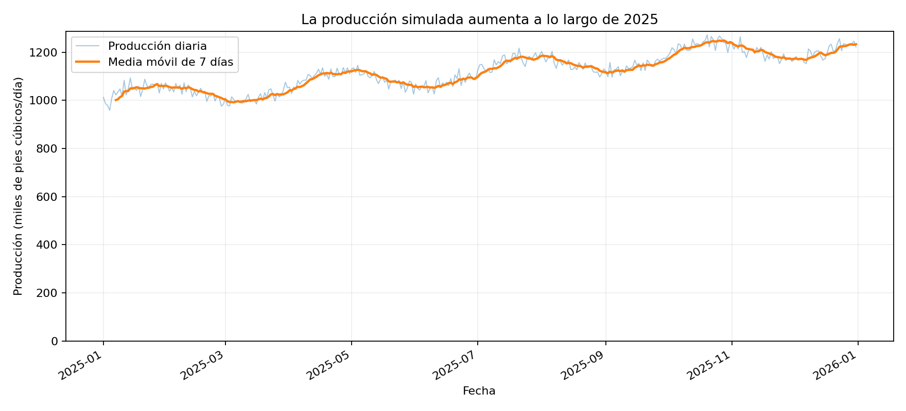
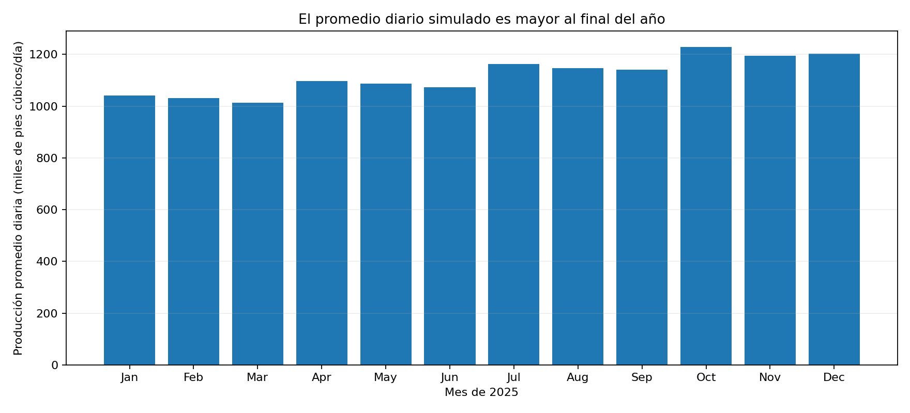

# Semana 14 — Análisis temporal de producción simulada de gas natural

## Objetivo
Analizar una serie temporal diaria simulada para identificar tendencia, oscilaciones y diferencias mensuales con Python, y proponer una consulta SQL.

## Origen de los datos
**Datos 100 % sintéticos, no reales.** Se generaron 365 registros diarios correspondientes a 2025, con semilla aleatoria 14, tendencia creciente, oscilación sinusoidal artificial de 90 días y ruido. No corresponden a una planta, empresa ni mediciones reales. La variable `produccion_mpcd` expresa una tasa diaria en miles de pies cúbicos por día. La suma de tasas diarias no se interpreta como volumen físico sin considerar la duración de cada periodo.

## Ejecución
Requiere Python 3.10+ y los paquetes `pandas`, `numpy` y `matplotlib` (numpy solo se necesita para regenerar el CSV). Desde esta carpeta:

```bash
pip install -r requirements.txt
python analisis.py
```

El programa carga `produccion.csv`, usa `resample('MS')` para obtener el promedio diario de cada mes y la suma de los registros diarios, y calcula una media móvil de 7 observaciones mediante `rolling(window=7)`. Guarda `resumen_mensual.csv` y dos imágenes en `graficos/`.

## Gráficos



La media móvil reduce el ruido diario y facilita ver la tendencia general. El eje vertical comienza en cero para evitar exagerar diferencias.



Se comparan **promedios diarios** de cada mes, no sumas mensuales, para evitar que la diferente cantidad de días distorsione la comparación. El eje de barras comienza en cero.

## Resultados
El promedio diario simulado pasa de **1042.12** en enero a **1203.50** miles de pies cúbicos/día en diciembre. **Octubre** presenta el promedio mensual más alto y **marzo** el más bajo. La serie tiene oscilaciones regulares **introducidas artificialmente** con un ciclo de 90 días. Estas oscilaciones no demuestran estacionalidad real de producción ni permiten inferir patrones de una planta; tampoco se dispone de varios años para evaluar estacionalidad anual.

## SQL: consulta e idea de optimización
`consulta.sql` incluye un índice sobre `fecha` y un filtro por intervalo de fechas (`fecha >= '2025-01-01' AND fecha < '2026-01-01'`) que permite potencialmente aprovecharlo. Selecciona solo las columnas necesarias y agrupa por mes usando `substr(fecha, 1, 7)` en SQLite, suponiendo fechas almacenadas como texto ISO `YYYY-MM-DD`. El índice no elimina el costo de la agrupación. Con 365 registros no se afirma una aceleración medida; se necesitarían `EXPLAIN QUERY PLAN` y pruebas de tiempo con un volumen mayor para verificar la mejora. Para ejecutar el SQL se debe importar `produccion.csv` en una tabla SQLite llamada `produccion` con columnas `fecha` (TEXT) y `produccion_mpcd` (REAL).

## Findings
The dataset contains 365 days of simulated natural gas production in 2025. The daily production rate shows an overall upward trend during the year. The seven-day moving average smooths short-term fluctuations and makes this trend easier to see. The first chart compares the daily observations with the moving average over time. The second chart compares the average daily production rate for each month, with October showing the highest monthly average and March the lowest. The data also contain an artificial 90-day cycle, so this pattern should not be interpreted as real-world seasonality. The SQL query filters the date range and calculates monthly indicators, while the date index may help on larger datasets.

## Entrega por GitHub
Copiar esta carpeta en la ruta correspondiente a la semana 14 del **fork del repositorio de clase**, respetando la estructura indicada por el docente. Desde el repositorio clonado, ejecutar `git add .`, `git commit -m "Semana 14: analisis temporal y visualizacion"` y `git push`. Verificar por separado que el repositorio de perfil tenga el bloque `CONFIG` con `FULL_NAME` y `GITHUB_USER` correctos.
