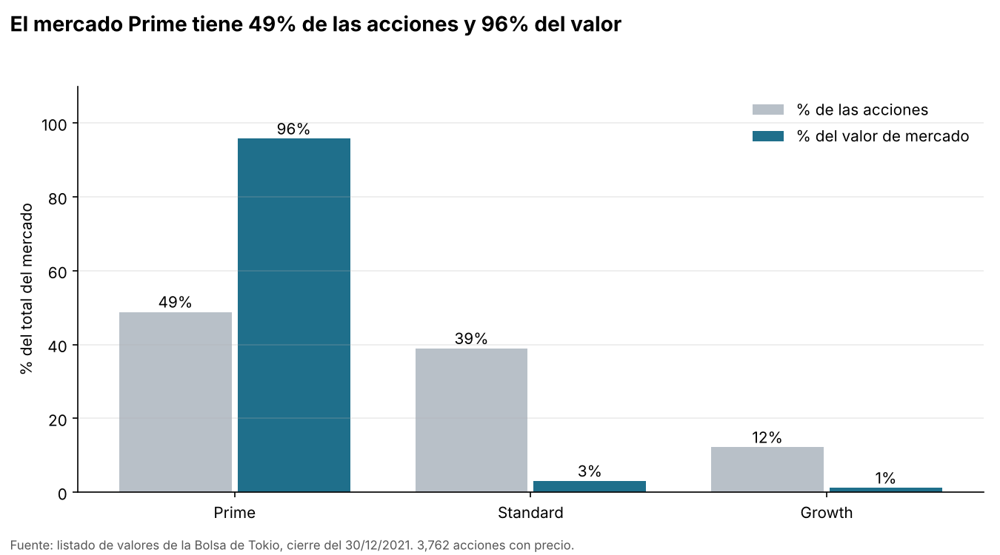

# Storytelling del proyecto final · Semana 15

**Estudiante:** Juan David Caviedes Cortes · **Usuario GitHub:** davidcaviedes499-ship-it
**Proyecto:** composición del mercado de acciones de la Bolsa de Tokio (cierre del 30/12/2021)

## 1. Contexto

Quien analiza el mercado de Tokio recibe un listado de más de 4.000 valores, y las acciones se dividen en tres mercados: Prime, Standard y Growth. Trabajé con las 3.762 acciones que tienen precio de cierre y mercado asignado, después de limpiar el archivo en la semana 9 (sin fondos ni filas sin precio).

## 2. Pregunta

Si hay que decidir a qué mercado dedicarle más tiempo de análisis, ¿cuál concentra lo que realmente mueve el valor del mercado?

## 3. Hallazgo

El mercado **Prime** tiene el **49%** de las acciones (1.838), pero reúne el **96%** del valor de mercado. Standard tiene el 39% de las acciones y solo el 3,1% del valor; Growth, el 12% de las acciones y el 1,2% del valor. Una empresa típica de Prime vale unas 10 veces más que una típica de Standard (capitalización mediana de ¥61 mil millones frente a ¥6 mil millones).

## 4. Recomendación accionable

Dedicar la revisión diaria al mercado Prime y pasar Standard y Growth a una revisión semanal. Con eso, el trabajo diario se concentra en la mitad de las acciones y aun así cubre el 96% del valor.

Para comprobar que funciona, durante el primer trimestre medir dos cosas: que la lista diaria (Prime) siga representando **al menos el 90% de la capitalización** (es el objetivo del KPI 1 del dashboard) y que las alertas importantes detectadas en Standard y Growth en la revisión semanal no superen, por ejemplo, el 10% del total de alertas. Si superan ese umbral, habría que subir la frecuencia de esos dos mercados.

Límite del análisis: es una foto de un solo día. Conviene repetir el cálculo con otras fechas antes de fijar la recomendación.

## 5. Revisión de títulos del dashboard (semana 13)

Cada vista del boceto tiene un título que enuncia una conclusión:

| Vista | Título |
|---|---|
| Acciones frente a valor por mercado | Prime tiene el 49% de las acciones y el 96% del valor |
| Sectores | Ningún sector pasa del 25%, pero dos están casi empatados |
| Precio de cierre | 39% de las acciones cierra por debajo de ¥1.000 |
| Gráfico clave de esta entrega | El mercado Prime tiene 49% de las acciones y 96% del valor |

Al revisarlos ajusté uno que decía "la mitad de las acciones" cuando el dato exacto es 48,7%, y puse la cifra concreta.

*Archivos: `captura_clave.png`, `captura_clave.py` (reproduce el gráfico y las cifras), `cifras_clave.txt`.*
